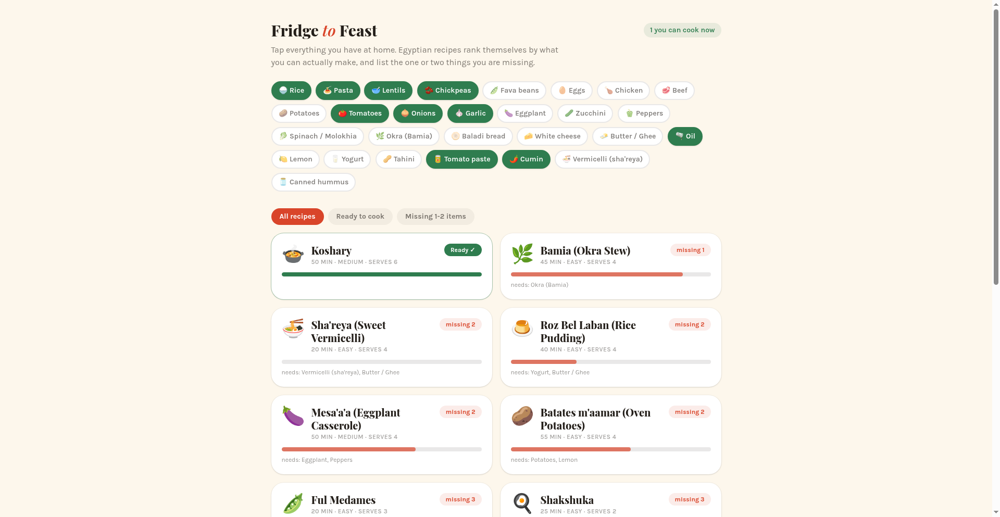

# Fridge to Feast

Tell it what is in your fridge and get real Egyptian recipes ranked by what you can cook right now - koshary, molokhia, ta'ameya, bamia and more - with the few missing items listed for each one.

**Live demo:** https://malakmo7amed309.github.io/fridge-to-feast/

## Standout feature

Ingredient-driven recipe matching. Tap what you have from a 28-item Egyptian pantry and every recipe instantly re-ranks by cookability: a progress bar shows how close you are, recipes you can make right now get a "Ready" badge, and everything else lists exactly which items are missing. Filters for ready-to-cook vs missing 1-2 items, expandable step-by-step instructions, and your fridge is saved in the browser.

## Stack

- React 19
- Tailwind CSS 4
- Vite (built to a single self-contained HTML file)
- No backend - pantry lives in localStorage

## Run it locally

```bash
npm install
npm run dev
```

```bash
npm run build
```

The build emits one self-contained `dist/index.html`, which GitHub Pages serves from the `docs/` folder.

## Screenshot


